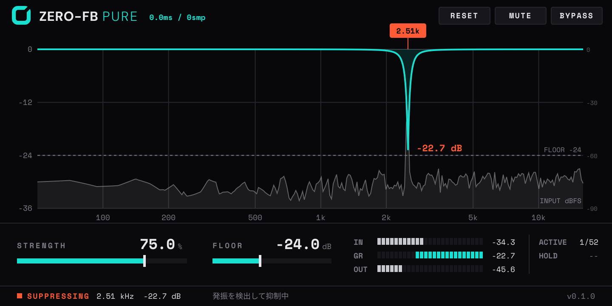

# ZERO-FB PURE

Zero-latency feedback (howling) suppressor built on plain DSP. No AI inference, no training, cut-only.

**Status: work in progress (v0.1.0 not released yet).** The zero-latency signal path, detection and control, the UI and the VST3 / AU builds are in place and pass pluginval (strictness 8) and auval in CI. Some closed-loop acceptance criteria are still unmet and are tracked as record-only tests (sections 13–16 of `docs/SPEC.md`). Builds are unsigned; there is no installer yet.




## What is here

| Path | Contents |
|---|---|
| `docs/SPEC.md` | The single source of truth: formulas, constants, state machine, test criteria (Japanese) |
| `docs/ui_master.svg` | UI design master, 560 x 280 |
| `source/dsp/` | Signal path: DC blocker, 40-band serial SVF EQ, band decoupling, safety guard, soft limiter. No JUCE dependency |
| `tests/` | `ZeroLatencyTest` ZL-1 to ZL-8, level / voice tests, closed-loop bench |
| `bench/` | PF-1 load measurement |

## Build and test

Requires CMake 3.22+ and a C++20 compiler. Catch2 v3.16.1 is fetched automatically.

```sh
cmake -S . -B build -DCMAKE_BUILD_TYPE=Release
cmake --build build --config Release
ctest --test-dir build -C Release --output-on-failure
```

## 日本語

設計のすべては [`docs/SPEC.md`](docs/SPEC.md) にあります。遅延 0 の信号経路、検出と制御、画面、VST3 / AU のビルドまで入っており、自動テストで pluginval（厳しさ 8）と auval に通っています。閉ループの合格基準の一部はまだ未達で、「記録のみ」のテストとして残しています（設計書の §13〜§16）。署名・公証とインストーラーはまだありません。

## License / ライセンス

ZERO-FB PURE is free software, licensed under the **GNU Affero General Public License v3.0** (AGPL-3.0-only). See [`LICENSE`](LICENSE).
Copyright (C) 2026 SEVENTHWELL.

ZERO-FB PURE は AGPLv3 で公開しています。全文は [`LICENSE`](LICENSE) にあります。

Third-party components / 同梱・利用している外部の部品:

| Component | License | Where |
|---|---|---|
| [JUCE](https://github.com/juce-framework/JUCE) 9.0.6 | AGPLv3 | fetched at build time (plug-in) |
| Orbitron Bold | SIL OFL 1.1 | `assets/fonts/OFL-Orbitron.txt` |
| Space Mono | SIL OFL 1.1 | `assets/fonts/OFL-SpaceMono.txt` |
| Noto Sans JP (subset) | SIL OFL 1.1 | `assets/fonts/OFL-NotoSansJP.txt` |
| [Catch2](https://github.com/catchorg/Catch2) v3.16.1 | BSL-1.0 | fetched at build time (tests only, not distributed) |
