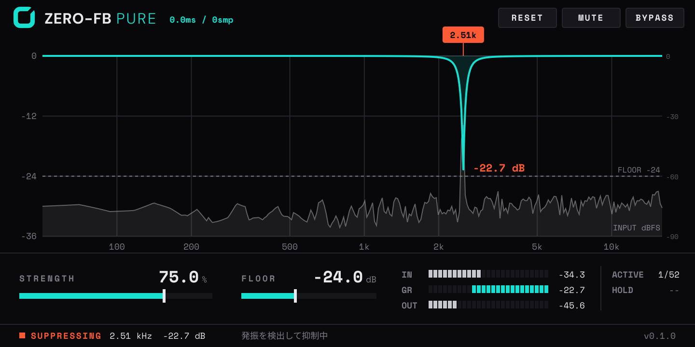

First pre-release of **ZERO-FB PURE**, a zero-latency (0 samples), pure-DSP, cut-only feedback suppressor (VST3 / AU). No AI, no look-ahead.

## Downloads

| File | Platform | Notes |
|---|---|---|
| `ZERO-FB-PURE-0.1.0.dmg` | macOS 11+ (Apple silicon and Intel) | VST3 and AU. Signed with a Developer ID and notarized by Apple |
| `ZERO-FB-PURE-0.1.0-windows-unsigned.zip` | Windows x64 | VST3. **Not code-signed** |

Install instructions are inside each download.

## What works

- 40-band cut-only EQ plus 12 moving notches, driven by a spectrum analysis that never touches the audio path (latency stays at 0 samples)
- Mono→Mono, Stereo→Stereo, Mono→Stereo at 44.1 / 48 / 96 kHz
- Live display: input spectrum, the suppression curve and the frequencies being cut
- Passes pluginval (strictness 8) on macOS and Windows, and auval, in CI

## Known limits (please read)

- **This is a pre-release.** It has passed automated tests only. It has not been checked in a DAW or at a real venue yet.
- Some closed-loop acceptance criteria are still unmet: applying +6 dB of loop gain abruptly, and part of the 120-second test. They are tracked as record-only tests; see sections 13–16 of `docs/SPEC.md`.
- A pure sine-like source (a whistle, a synth tone, a tuning tone) can be cut as if it were feedback. Lower STRENGTH or use BYPASS.
- CPU load on Apple M4 has not been measured.

## 日本語

ZERO-FB PURE の最初のプレリリースです。遅延 0 サンプル・AI なし・カット専用のハウリング抑制プラグイン（VST3 / AU）です。

- Mac 用の `.dmg` は Developer ID で署名し、Apple の公証を通してあります。Windows 用の `.zip` は署名なしです。
- 自動テストに通っただけの段階で、DAW や実際の会場ではまだ確認していません。
- 閉ループの合格基準の一部（いきなり +6 dB かける条件、120 秒テストの一部）は未達です。詳しくは `docs/SPEC.md` の §13〜§16 にあります。
- 口笛やシンセの単音のような純粋なサイン波に近い音は、ハウリングと見分けられずに切ることがあります。

License: GNU AGPL v3.0.
